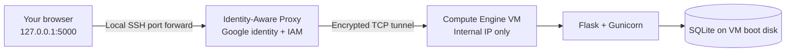

# Demo Runbook

This runbook describes the live Cloud Inventory demonstration on a private Google Cloud Compute Engine VM. The GitHub Pages preview is a separate static sample and is not evidence that the Flask service is deployed.

## Architecture

The VM has no external IP. You open the application on your laptop through an IAP tunnel; the VM does not expose the Flask port to the internet. The tunnel command and VM setup are in [GCP_DEPLOYMENT.md](GCP_DEPLOYMENT.md).

## Pre-demo checks

1. Confirm the VM is running in the intended project and zone, and that its external IP field is empty.
2. Start the IAP port-forwarding command from the deployment guide and keep that terminal open.
3. Open `http://127.0.0.1:5000` and confirm the inventory page loads.
4. Open `http://127.0.0.1:5000/health` and confirm it returns `{"status":"healthy"}`.

## Demonstration sequence

1. In the Google Cloud console, show the VM name, machine type, zone, and absence of an external IP.
2. Explain that IAP checks Google identity and IAM authorization before forwarding the connection.
3. Show the Flask inventory page through the local tunnel.
4. Open the product catalog and demonstrate search or category filtering.
5. Record a stock-in or stock-out transaction and show the updated quantity and activity entry.
6. Open the low-stock view to show threshold-based alerts, then visit the health endpoint.
7. Explain that the image supports local container use, while this private VM guide runs the Python application directly on the VM.

## Screenshot evidence

Capture screenshots from the actual deployed VM and save them under [`docs/screenshots/`](docs/screenshots/). Do not label the GitHub Pages sample as the GCP-hosted app.

| Filename | Capture |
| --- | --- |
| `01-compute-engine-private-vm.png` | Compute Engine VM list with machine type, zone, and no external IP visible. |
| `02-inventory-dashboard.png` | Dashboard open through the IAP tunnel. |
| `03-product-catalog.png` | Product catalog with a sample search or category filter applied. |
| `04-stock-transaction.png` | Stock movement after a sample stock-in or stock-out transaction. |
| `05-low-stock-alerts.png` | Low-stock view with threshold alerts. |
| `06-application-health.png` | `/health` response in the browser. |

Before committing screenshots, remove browser tabs or account details that are not needed for the evidence. Only use sample inventory data. Add the images to Git and reference them in the README if you want them displayed on the repository front page.

## Shutdown

After the demo, delete the VM and its boot disk if you no longer need them. Use the cleanup commands at the end of [GCP_DEPLOYMENT.md](GCP_DEPLOYMENT.md), then check the Cloud Billing report later; cost data can be delayed.
