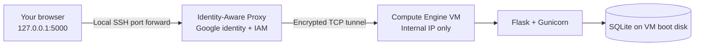

# Demo Runbook

This runbook describes the live Cloud Inventory demonstration on a private Google Cloud Compute Engine VM. The GitHub Pages preview is a separate static sample and is not evidence that the Flask service is deployed.

## Architecture

The VM has no external IP. You open the application on your laptop through an IAP tunnel; the VM does not expose the Flask port to the internet. The tunnel command and VM setup are in [GCP_DEPLOYMENT.md](GCP_DEPLOYMENT.md).

## Pre-demo checks

1. If the VM is stopped, start it with the command in the deployment guide and wait until its status is `RUNNING`.
2. Start the app in the VM, then start the IAP port-forwarding command from the deployment guide and keep that terminal open.
3. Open `http://127.0.0.1:5000` and confirm the inventory page loads.
4. Open `http://127.0.0.1:5000/health` and confirm it returns `{"status":"healthy"}`.

## Demonstration sequence

1. Open the [Compute Engine VM list](https://console.cloud.google.com/compute/instances?project=cloud-inventory-demo) and show the VM name, machine type, zone, and absence of an external IP.
2. Explain that IAP checks Google identity and IAM authorization before forwarding the connection.
3. Show the Flask inventory page through the local tunnel.
4. Open the product catalog and demonstrate search or category filtering.
5. Record a stock-in or stock-out transaction and show the updated quantity and activity entry.
6. Open the low-stock view to show threshold-based alerts, then visit the health endpoint.
7. Explain the architecture: Compute Engine provides the VM, IAP provides authenticated private access, and SQLite stores inventory on the VM disk.

## Screenshot evidence

The screenshots under [`docs/screenshots/`](docs/screenshots/) were captured from the actual deployed VM through the IAP tunnel. Do not label the GitHub Pages sample as the GCP-hosted app.

| Filename | Capture |
| --- | --- |
| `01-inventory-dashboard.png` | Dashboard open through the IAP tunnel. |
| `02-product-catalog.png` | Product catalog with the Electronics category filter applied. |
| `03-stock-transaction.png` | Stock audit log after a sample stock-in transaction. |
| `04-low-stock-alerts.png` | Low-stock view with sample threshold alerts. |
| `05-application-health.png` | `/health` response in the browser. |

To show infrastructure details, open the VM in the Compute Engine console and point out its `e2-micro` machine type, zone, and empty external IP field. Only sample inventory data is used in the screenshots.

## Shutdown

After the demo, stop the VM to preserve its data without paying for running compute. Delete the VM and its boot disk if you no longer need the demo. Use the commands at the end of [GCP_DEPLOYMENT.md](GCP_DEPLOYMENT.md), then check Cloud Billing later; cost data can be delayed.
