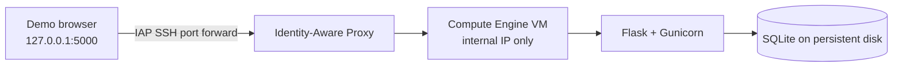
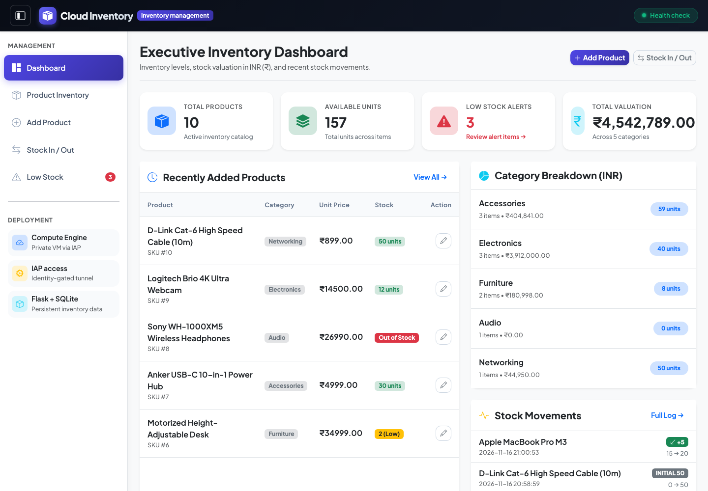

# Cloud Inventory: Private Inventory Management on Google Cloud

A Flask inventory management application with a private Google Cloud deployment path. It uses SQLite for persistence and provides product catalog management, stock movement tracking, low-stock alerts, and an application health endpoint.

## Project overview

Cloud Inventory is a Flask inventory application with a dashboard, product catalog, stock operations, and low-stock alerts. It uses SQLite for persistence and Gunicorn as the WSGI server. The `/health` endpoint verifies database connectivity.

The application supports creating, editing, searching, filtering, and deleting products; recording stock-in and stock-out transactions; viewing recent activity; and monitoring configurable low-stock thresholds. Example inventory is seeded into an empty database at first launch.

## Target architecture

The private GCP deployment guide describes this architecture; no GCP VM is created automatically by this repository.



## Private GCP deployment

Follow [GCP_DEPLOYMENT.md](GCP_DEPLOYMENT.md) to create an e2-micro Compute Engine VM with no external IP, transfer the app and dependencies over IAP, and open it from your laptop through a private tunnel. The guide includes start, stop, and delete commands. Compute Engine requires billing; Free Tier eligibility depends on the region and billing-account usage, so a $0 bill is not guaranteed.

For the live demo sequence and screenshot evidence checklist, see the [demo runbook](DEMO_RUNBOOK.md).

## Live VM screenshots

These screenshots show the Flask app running on the private Compute Engine VM and viewed from the laptop through IAP. The app itself has no public IP or public website URL.



[Product catalog](docs/screenshots/02-product-catalog.png) · [Stock transaction](docs/screenshots/03-stock-transaction.png) · [Low-stock alerts](docs/screenshots/04-low-stock-alerts.png) · [Health endpoint](docs/screenshots/05-application-health.png)

## Online preview

The [interactive sample inventory](https://nirvaanv.github.io/cloud-inventory/) is hosted with GitHub Pages and stays available when your computer is offline. It uses sample data saved in each visitor's browser; it is not connected to the Flask app or its SQLite database. To publish or republish it, open **Settings → Pages**, choose **Deploy from a branch**, select `main` and `/docs`, then save. GitHub publishes `docs/index.html` at the preview link above.

The Pages site is an interactive sample that saves changes in each visitor's browser. The Flask backend and SQLite database run on the private GCP VM described in [GCP_DEPLOYMENT.md](GCP_DEPLOYMENT.md). Local and Docker commands below are development options.

## Local development

Requires Python 3.9 or newer.

```bash
python3 -m venv .venv
source .venv/bin/activate
pip install -r requirements-dev.txt
pytest -v
python app.py
```

Open http://127.0.0.1:5000. Data is stored in `instance/inventory.db` by default. The test suite covers Flask routes, product validation, stock operations, database behavior, and the health endpoint.

## Run with Docker

```bash
docker build -t cloud-inventory .
docker run --rm -p 5000:5000 -v inventory-data:/data cloud-inventory
```

Open http://127.0.0.1:5000. The named volume keeps the SQLite database between container replacements. Check `http://127.0.0.1:5000/health` for the health response.

