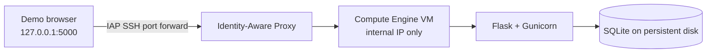

# Cloud Inventory

A small Flask inventory app for a cloud computing project. It demonstrates an HTTP application, a health endpoint, a container image, and SQLite data stored at a configurable path.

## Project overview

Cloud Inventory is a compact demonstration application for tracking product names and quantities. It uses Flask for HTTP routes and server-rendered pages, SQLite for persistence, and Gunicorn as the production WSGI server. The `/health` endpoint performs a database connectivity check.

The application supports adding products and viewing the inventory. It is intentionally scoped as a small cloud deployment example rather than a production inventory system.

## Target architecture

The private GCP deployment guide describes this architecture; no GCP VM is created automatically by this repository.



## GCP deployment

For a private Compute Engine demo with no external IP, follow [GCP_DEPLOYMENT.md](GCP_DEPLOYMENT.md). It copies the app and dependencies to an e2-micro VM and provides access through an IAP tunnel to your own laptop. The VM is not publicly reachable, and the guide includes cleanup commands. Compute Engine still requires billing; Free Tier eligibility depends on region and account usage, so a $0 bill is not guaranteed.

For the live demo sequence and screenshot evidence checklist, see the [demo runbook](DEMO_RUNBOOK.md).

The screenshot folder contains capture instructions only until an actual GCP VM is deployed; it does not include fabricated cloud screenshots.

## Online preview

The [interactive sample inventory](https://nirvaanv.github.io/cloud-inventory/) is hosted with GitHub Pages and stays available when your computer is offline. It uses sample data saved in each visitor's browser; it is not connected to the Flask app or its SQLite database. To publish or republish it, open **Settings → Pages**, choose **Deploy from a branch**, select `main` and `/docs`, then save. GitHub publishes `docs/index.html` at the preview link above.

For the real Flask application, follow the local or Docker instructions below. The static preview is intended as a permanent project showcase, not a live backend deployment.

## Run locally

Requires Python 3.12+.

```bash
python3 -m venv .venv
source .venv/bin/activate
pip install -r requirements.txt
python app.py
```

Open http://127.0.0.1:5000. Data is stored in `instance/inventory.db` by default. Set `DATABASE_PATH` to change the location.

## Run with Docker

```bash
docker build -t cloud-inventory .
docker run --rm -p 5000:5000 -v inventory-data:/data cloud-inventory
```

Open http://127.0.0.1:5000. The named volume keeps the SQLite database between container replacements. Check `http://127.0.0.1:5000/health` for the health response.

